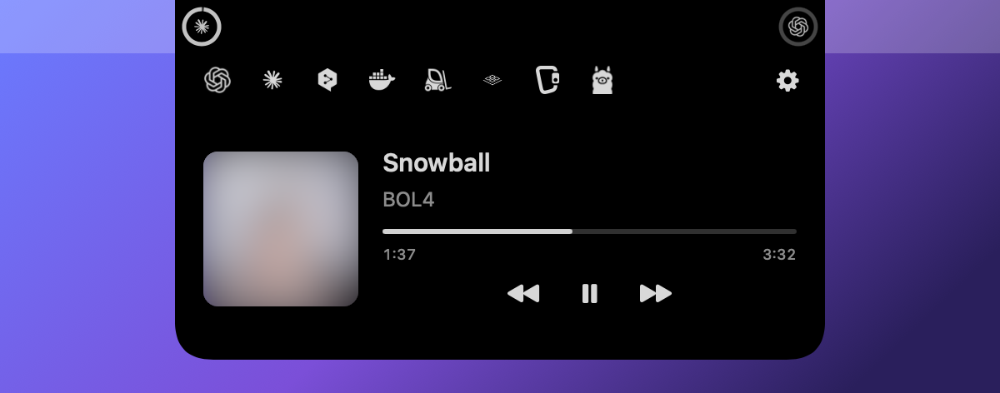
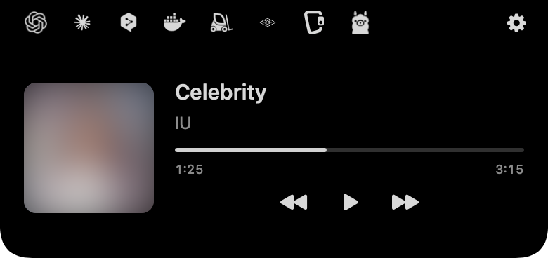
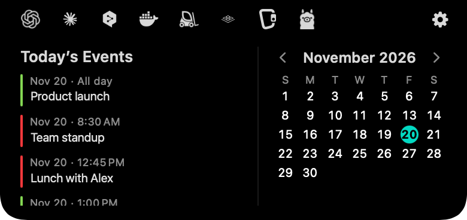
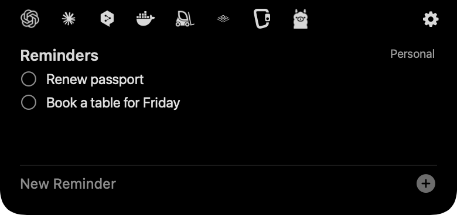
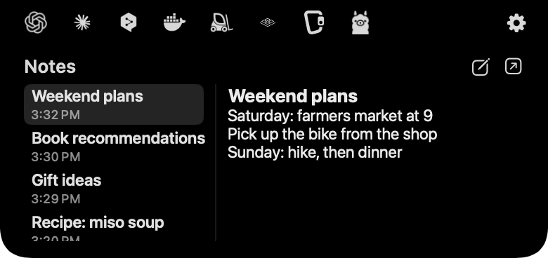

# Notch Shelf

[English](README.md) | **한국어**

<p align="center">
  
</p>
<p align="center">
  
</p>

노치에 포인터를 올려 평소 메뉴 막대에서 숨겨 둔 앱을 사용합니다. CPU 사용률처럼 계속 보고 싶은 항목은 원래 메뉴 막대에 둘 수 있습니다.

영어, 한국어, 일본어, 중국어(간체·번체), 프랑스어, 독일어, 러시아어를 지원합니다. 기본값은 macOS의 선호 언어이며, 시스템 설정의 **일반 → 언어 및 지역 → 응용 프로그램**에서 Notch Shelf에 사용할 언어를 따로 선택할 수 있습니다.

## 노치 양옆

접힌 노치 왼쪽에는 Claude와 Codex 사용량이 번갈아 표시됩니다. 링의 옅은 흰색 부분은 남은 양을, 짙은 회색 부분은 사용한 양을 나타냅니다. 가운데 로고로 서비스를 구별할 수 있고, 어느 사용량 링에 포인터를 올려도 Claude와 Codex 사용량이 한 창에 표시됩니다. 서비스별로 제공되는 5시간 한도와 주간 한도의 사용률과 초기화까지 남은 시간을 한 줄씩 볼 수 있습니다. 오른쪽은 재생 중이면 일시정지(Ⅱ), 멈추면 재생(▶) 버튼이 됩니다.

노치 패널의 **톱니바퀴 → 환경설정…**에서 가운데 **위젯과 앱** 목록의 항목을 원하는 쪽으로 끌어 놓으세요. 같은 쪽에서 순서를 바꾸거나, 반대쪽으로 옮기거나, 가운데로 돌려놓아 뺄 수 있습니다. 여러 개면 각 쪽에서 6초마다 차례로 표시하며 포인터를 올린 동안은 순환을 멈춥니다. 하나면 고정되고 비우면 접힌 노치의 해당 표시가 사라집니다. 배치는 재실행 후에도 유지됩니다.

사용량 위젯을 배치하면 Codex는 약 2분마다, Claude는 약 5분마다 로그인된 로컬 CLI에서 구독 한도를 자동으로 읽습니다. 앱 시작과 잠자기 해제 때도 갱신합니다. Claude는 독립 설치한 Claude Code 또는 Claude 데스크톱이 설치한 CLI를 사용합니다. 처음에는 **환경설정 → Claude 계정 연결…**에서 브라우저 로그인을 한 번 마치세요. 이후에는 사용량 화면을 열 필요가 없습니다. 데스크톱 기록이나 열린 사용량 화면은 CLI 조회 실패 시 보조 자료로 사용합니다. 5시간 한도를 우선하며 계정이 주간 한도만 제공하면 그 값을 표시합니다. 최근 값을 확인할 수 없으면 링이 점선이 됩니다.

메뉴 막대 항목이 옆 공간을 차지하면 해당 표시가 자리를 비웁니다. 노치가 없는 화면에서는 기존 상단 중앙 패널을 사용할 수 있습니다.

## 앱 배치

1. `build/NotchShelf.app`을 열고 노치 위에 포인터를 올립니다. 권한 안내가 나타나면 **권한 설정 바로 열기**에서 **NotchShelf.app**을 허용합니다. macOS 27에서는 **기기 제어 및 데이터 접근**(Device Control and Data Access)입니다.
2. 오른쪽 톱니바퀴 메뉴에서 **앱 배치**를 누릅니다. 각 행의 오른쪽에 현재 지정한 위치가 표시됩니다. 앱 이름을 누르면 **메뉴 막대**와 **노치** 사이를 전환합니다.
3. **완료**를 누르면 노치로 보낸 앱의 항목만 남습니다. 아이콘을 누르면 해당 앱의 실제 메뉴가 열립니다. 여러 화면을 쓰면 노치가 있는 화면의 메뉴 막대에서 해당 아이콘을 찾아 엽니다. **앱 배치**에서 같은 행을 다시 누르면 메뉴 막대로 돌아갑니다.

처음에는 모든 앱을 메뉴 막대에 둡니다. 기존 버전에서 고정했던 앱도 직접 이동할 수 있습니다. 한 앱이 여러 아이콘을 제공하면 함께 이동합니다. 시계와 제어 센터 같은 시스템 항목은 메뉴 막대에 둡니다. 배치는 재실행 후에도 적용되며, Notch Shelf를 종료하면 메뉴 막대가 원래 상태로 돌아옵니다. 앱 자체와 macOS가 정한 표시 설정, 메뉴 막대의 공간 부족에 따른 기본 접힘은 그대로 적용됩니다.

## 펼친 패널

노치 바로 아래에는 앱의 메뉴 막대용 아이콘이 한 줄로 표시됩니다. 줄이 넘치면 아이콘 영역에서 트랙패드를 두 손가락으로 좌우로 쓸거나 양쪽 끝에 포인터를 두어 스크롤합니다. 톱니바퀴 메뉴에서 앱 배치, 새로고침, 환경설정, 종료를 선택할 수 있습니다. 환경설정에서 **손쉬운 사용 설정…**을 누르면 macOS의 해당 권한 화면이 열립니다. 메뉴 막대용 리소스를 제공하지 않거나 인식할 수 없는 앱은 첫 글자로 표시합니다.

노치 아래 아이콘 줄 밑에는 정보 카드가 있습니다. 카드 위에서 두 손가락으로 좌우로 쓸거나 왼쪽·오른쪽 가장자리에 포인터를 잠시 두면 **음악 → 캘린더 → 미리 알림 → 메모** 순서로 돌아가며 전환됩니다. 각 카드는 처음에 **연결** 버튼으로 해당 권한을 요청하며, 이전에 거부했다면 버튼이 시스템 설정의 해당 화면을 엽니다.

환경설정의 **로그인 시 열기**를 켜면 로그인할 때 Notch Shelf가 자동으로 실행됩니다.

<sub>아래 스크린샷의 일정·미리 알림·메모 내용은 예시 문구이며, 앨범 커버는 흐리게 처리했습니다.</sub>

### 음악



- **Apple Music** 또는 **Spotify**에서 재생 중인 곡의 제목, 아티스트, 앨범 커버, 재생 시간과 전체 길이를 보여 줍니다.
- 재생바를 끌어 원하는 위치로 이동합니다.
- 이전 곡, 재생/일시정지, 다음 곡 버튼으로 플레이어를 바로 제어합니다.
- 두 플레이어가 모두 열려 있으면 재생 중인 쪽을 따라갑니다.
- **재생 정보 연결**(해당 플레이어에 대한 자동화 권한)이 필요합니다.

노치 옆의 **재생/일시정지** 위젯은 미디어 키를 보내는 방식이라, 브라우저 동영상이나 팟캐스트, IINA, VLC 같은 다른 앱도 제어합니다.

### 캘린더



- 왼쪽에는 선택한 날의 일정이 캘린더 색상과 함께 표시됩니다. 종일 일정과 여러 날에 걸친 일정도 포함합니다.
- 오른쪽은 월 달력입니다. 오늘이 강조되고, 날짜를 누르면 그날 일정이 왼쪽에 나오며, ‹ › 로 달을 넘깁니다.
- 패널을 열면 항상 오늘이 선택되고, 캘린더가 바뀌면 목록도 갱신됩니다.
- **캘린더 연결**(캘린더 전체 접근 권한)이 필요합니다.

### 미리 알림



- Apple 미리 알림의 기본 목록에서 미완료 항목을 보여 주고, 오른쪽 위에 목록 이름을 표시합니다.
- 항목 왼쪽의 원을 누르면 완료됩니다.
- **새 미리 알림**에 제목을 입력하고 Return이나 **+**를 누르면 같은 목록에 추가됩니다.
- 사용할 목록은 미리 알림 앱의 설정 → 기본 목록에서 바꿉니다.
- **미리 알림 연결**(미리 알림 전체 접근 권한)이 필요합니다.

### 메모



- Apple 메모에서 최근에 수정한 메모 40개를 보여 주고, 하나를 누르면 오른쪽에서 읽을 수 있습니다.
- 카드에서 바로 메모를 고칠 수 있습니다. 입력을 멈추면 잠시 뒤 자동으로 저장되며 *저장 중…*, *저장됨*으로 상태를 알려 줍니다.
- 연필 버튼으로 새 메모를 시작합니다. 첫 줄이 제목이 되고, 내용을 입력하면 메모 앱의 기본 폴더에 저장됩니다.
- 화살표 버튼은 선택한 메모를 메모 앱에서 엽니다.
- 이미지, 체크리스트, 표, 서식이 있는 메모는 일반 텍스트로 저장하면 손상될 수 있어 *읽기 전용*으로 표시합니다. 이런 메모는 메모 앱에서 고치세요. 잠긴 메모는 잠긴 채로 둡니다.
- 여기서 편집하는 동안 메모 앱에서 같은 메모가 바뀌면 덮어쓰지 않고, 메모 앱에서 확인하라는 경고를 보여 줍니다.
- **메모 연결**(메모 앱에 대한 자동화 권한)이 필요합니다. 필요하면 메모 앱을 백그라운드에서 실행합니다.

## 호환성

앱별 숨김은 macOS 27의 비공개 MenuBarClientCore 인터페이스를 사용합니다. 이후 macOS에서 이 인터페이스를 찾지 못하면 메뉴 막대 항목을 여는 기본 패널을 제공합니다. macOS 업데이트로 인터페이스가 달라질 수 있습니다. 숨김 적용에 실패하면 필터를 해제합니다.

macOS 27에서 숨김 필터는 알림 센터 열기에도 영향을 줍니다. 시계에 포인터를 올리면 필터를 잠시 풀어 시계 클릭으로 알림 센터를 열 수 있게 합니다. 이때 숨긴 앱이 잠시 보일 수 있고, 숨김 중에는 트랙패드 제스처나 단축키로 알림 센터를 여는 동작이 제한될 수 있습니다.

## 빌드

SwiftUI와 AppKit으로 만든 macOS 27 이상용 앱입니다. Xcode에서 `NotchShelf.xcodeproj`를 열어 실행하거나 프로젝트 폴더에서 빌드합니다.

```sh
xcodebuild -project NotchShelf.xcodeproj -scheme NotchShelf -configuration Release \
  -derivedDataPath build CONFIGURATION_BUILD_DIR="$PWD/build" build
open build/NotchShelf.app
```

Debug와 Release 모두 **Apple Development** 인증서와 번들 ID `dev.chopnchop.notchshelf`로 서명하며, Hardened Runtime을 켭니다. 처음에는 Xcode의 **Settings → Apple Accounts**에서 로그인하고, 본인의 팀 ID를 `Config/Signing.local.xcconfig`에 적습니다. 이 파일은 git에 올라가지 않습니다.

```
DEVELOPMENT_TEAM = ABCDE12345
```

명령줄에서 Xcode가 개발 인증서를 발급해야 할 때는 위 빌드 명령에 `-allowProvisioningUpdates`를 추가합니다.

### 배포용 DMG

`scripts/release.sh`는 앱을 빌드하고 서명을 확인한 뒤 `dist/`에 DMG를 만듭니다. 인자 없이 실행하면 개발 인증서로 서명한 테스트용 DMG를 만들며, 공증하지 않으므로 다른 Mac에서는 열리지 않습니다. 배포용은 유료 Apple Developer Program의 **Developer ID Application** 인증서로 서명하고 공증합니다.

```sh
xcrun notarytool store-credentials notchshelf --apple-id you@example.com --team-id ABCDE12345
TEAM_ID=ABCDE12345 NOTARY_PROFILE=notchshelf scripts/release.sh
```

기존 임시 서명 버전에서 처음 전환할 때는 실행 중인 앱을 종료하고 새 앱을 연 뒤 손쉬운 사용 권한을 한 번 허용합니다. 이전 권한이 켜져 있어도 새 앱이 인식하지 못하면 `tccutil reset Accessibility dev.chopnchop.notchshelf`으로 이 앱의 기존 권한만 초기화하고, 권한 목록의 **+**로 `build/NotchShelf.app`을 추가합니다. 이후 같은 서명 요건으로 빌드한 업데이트에는 기존 허용이 적용됩니다.

## 라이선스

[MIT License](LICENSE) © 2026 chopnchop.dev
