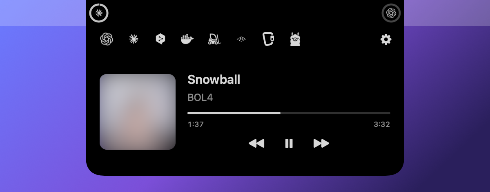
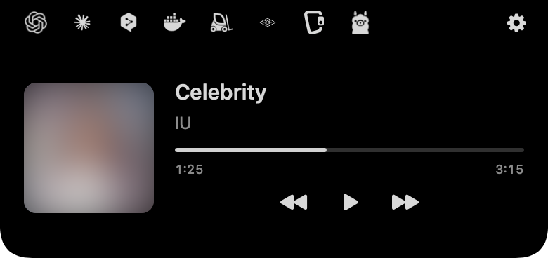
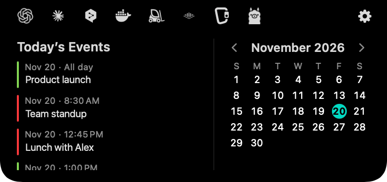
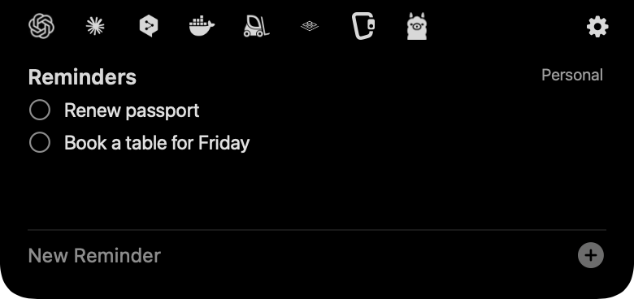
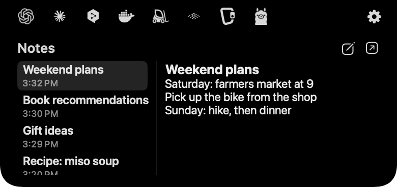

# Notch Shelf

**English** | [한국어](README.ko.md)

<p align="center">
  
</p>
<p align="center">
  
</p>

Notch Shelf moves menu bar apps you rarely look at into the MacBook notch. Point at the notch to open a shelf with those apps, the current track, your calendar and reminders. Items you want to see all the time, such as a CPU meter, stay in the menu bar.

It is available in English, Korean, Japanese, Simplified and Traditional Chinese, French, German and Russian. It follows your preferred macOS language; to choose another one for Notch Shelf only, go to **System Settings → General → Language & Region → Applications**.

Requires macOS 27 or later on a Mac with a notch.

## Beside the notch

The collapsed notch can show a small widget on each side:

- **Claude and Codex usage**: a ring with the service's logo. The light part is what is left, the dark part what is used. Point at either ring to see both services' 5-hour and weekly limits with the time until each resets. A dotted ring means no recent reading.
- **Play / Pause** for whatever is playing.
- **Mac thermal state**.
- **Any menu bar app** you moved to the notch; click it to open its menu.

Click the **gear** and look under **Collapsed Notch**. Drag items from **Widgets and Apps** in the middle to the left or right column. Drag within a column to reorder, or back to the middle to remove. With several items on one side, they take turns every 6 seconds, pausing while the pointer is over them. If menu bar items need the space beside the notch, the widget on that side steps aside.

### Usage limits

With a usage widget placed, Notch Shelf reads your subscription limits from the signed-in command line tools on this Mac: Codex about every 2 minutes, Claude about every 5 minutes, and again at launch and on wake. Nothing is sent anywhere else.

- **Claude** uses Claude Code, installed on its own or by the Claude desktop app. Sign in once with **Settings → Connect Claude Account…**. If the CLI can't be reached, the desktop app's usage history or an open usage page is used instead.
- **Codex** uses the Codex CLI, installed on its own or bundled with the Codex app.

The 5-hour limit is shown first; accounts with only a weekly limit show that. Checks pause while the displays sleep and back off while a CLI is missing or signed out.

## Moving apps into the notch

1. Open Notch Shelf and point at the notch. When asked, allow **NotchShelf** in **System Settings → Privacy & Security → Device Control and Data Access**.
2. Click the gear and look under **Arrange Apps**. Each row shows where the app is now; click a row to switch it between **Menu Bar** and **Notch**.
3. Changes apply immediately. Apps sent to the notch disappear from the menu bar and appear in the shelf. Click an icon to open that app's real menu. To move an app back, click its row in **Arrange Apps** again.

At first, every app stays in the menu bar. Apps with several icons move together. System items such as the clock and Control Center always stay in the menu bar. Your arrangement is kept across restarts, and quitting Notch Shelf restores the full menu bar.

## The open shelf

The row under the notch shows the menu bar icons of the apps you moved. If they don't fit, swipe sideways with two fingers or rest the pointer at either end to scroll. The gear opens one window for widget and app placement, usage limits, permissions, login and quitting the app. Apps without a usable menu bar image are shown by their first letter.

**Settings → Open at Login** starts Notch Shelf when you log in.

Below the row is a card. Swipe sideways with two fingers, or rest the pointer near the left or right edge, to move between **Music → Calendar → Reminders → Notes** and back around. Each card asks for its own permission the first time with a **Connect** button; if you declined earlier, the button opens the matching page in System Settings instead.

<sub>Event, reminder and note text in the screenshots below is sample text, and the album cover is blurred.</sub>

### Music



- Shows the current track from **Apple Music** or **Spotify**: title, artist, artwork, elapsed and total time.
- Drag the progress bar to jump to another position.
- Previous, play/pause and next control the player directly.
- If both players are open, the card follows the one that is playing.
- Needs **Connect Player** (Automation permission for that player).

The **Play / Pause** widget beside the notch works differently: it sends the media key, so it also controls videos in a browser, Podcasts, IINA, VLC and other apps.

### Calendar



- The left side lists the selected day's events with each calendar's color, including all-day events and events that span several days.
- The right side is a month grid. Today is highlighted; click any date to see its events, and use ‹ › to change months.
- The shelf always opens on today, and the list updates when your calendars change.
- Needs **Connect Calendar** (full access to Calendars).

### Reminders



- Shows the unfinished reminders in your default Apple Reminders list; the list's name is shown at the top right.
- Click the circle to complete a reminder.
- Type in **New Reminder** and press Return or **+** to add one to the same list.
- Change which list is used in Reminders → Settings → Default List.
- Needs **Connect Reminders** (full access to Reminders).

### Notes



- Lists your 40 most recently edited Apple Notes; click one to read it on the right.
- Edit a note right in the card. Changes save automatically a moment after you stop typing, and the status shows *Saving…* and *Saved*.
- Click the pencil to start a new note. The first line becomes its title, and it's saved to your default Notes folder once you type something.
- Click the arrow to open the selected note in Notes.
- Notes with images, checklists, tables or formatting are *View only*, so saving plain text can't damage them; open them in Notes to edit. Locked notes stay locked.
- If a note changed in Notes while you were editing it here, your edit isn't saved over it; a warning asks you to check the note in Notes.
- Needs **Connect Notes** (Automation permission for Notes). Notes is started in the background when needed.

## Compatibility

Hiding individual apps relies on the private MenuBarClientCore interface in macOS 27, so a macOS update may change or break it. If the interface is missing or a layout can't be applied, Notch Shelf removes its filter and falls back to a shelf that opens your menu bar items.

The filter also affects opening Notification Center. When the pointer is over the clock, Notch Shelf lifts the filter briefly so a click on the clock still opens it. Hidden apps may flash into view at that moment, and the trackpad gesture or shortcut for Notification Center may not work while apps are hidden.

## Building

Notch Shelf is a SwiftUI and AppKit app for macOS 27 or later. Open `NotchShelf.xcodeproj` in Xcode, or build from the project folder:

```sh
xcodebuild -project NotchShelf.xcodeproj -scheme NotchShelf -configuration Release \
  -derivedDataPath build CONFIGURATION_BUILD_DIR="$PWD/build" build
open build/NotchShelf.app
```

The app is signed with an **Apple Development** certificate, uses the bundle ID `dev.chopnchop.notchshelf`, and runs with the Hardened Runtime. Sign in to Xcode under **Settings → Apple Accounts**, then put your team ID in `Config/Signing.local.xcconfig`, which git ignores:

```
DEVELOPMENT_TEAM = ABCDE12345
```

If Xcode needs to create a development certificate from the command line, add `-allowProvisioningUpdates` to the build command.

If macOS no longer recognizes the app's permission after you switch signing, run `tccutil reset Accessibility dev.chopnchop.notchshelf`, then add `build/NotchShelf.app` again with **+** in the permission list. Later builds with the same signature keep the permission.

### Release DMG

`scripts/release.sh` builds the app, checks its signature and creates a DMG in `dist/`. Without arguments it signs with your development certificate for local testing; that DMG is not notarized and won't open on other Macs. A release is signed with a **Developer ID Application** certificate from the paid Apple Developer Program and notarized:

```sh
xcrun notarytool store-credentials notchshelf --apple-id you@example.com --team-id ABCDE12345
TEAM_ID=ABCDE12345 NOTARY_PROFILE=notchshelf scripts/release.sh
```

## License

[MIT License](LICENSE) © 2026 chopnchop.dev
